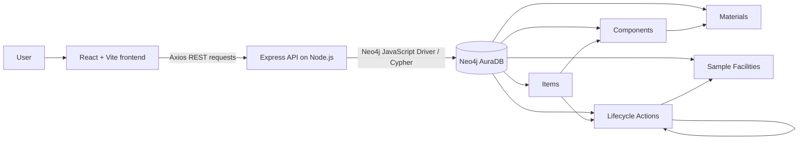

# CircularLoop – Smart Repair, Reuse and Recycling Finder

CircularLoop is a full-stack educational application that helps people explore repair, reuse, refurbishment, material recovery and recycling options for unwanted electronics. Its curated knowledge base is stored in **Neo4j AuraDB**. The application follows graph relationships rather than reading a local JSON dataset.

## 1. Problem statement and objectives

Electronic products contain reusable components and recoverable materials. A device that is no longer useful to its owner may still have a repairable fault, working parts or materials that can re-enter a production cycle. CircularLoop demonstrates how a graph database can connect a device to its components, materials, lifecycle actions and sample facilities.

Objectives:
- Explore a manually curated catalogue of electronic items.
- Inspect component and material composition.
- Recommend lifecycle pathways using graph traversal and transparent condition rules.
- Visualize actual Neo4j nodes and relationships.
- Manage custom lifecycle action nodes with CRUD operations.
- Demonstrate a practical, explainable NoSQL graph application.

Recommendations are rule-based demonstrations, not AI diagnosis or professional repair advice. Facility records are fictional/sample entries for application demonstration and are not verified providers.

## 2. Technology stack

| Layer | Technology |
|---|---|
| Frontend | React 18, Vite, Tailwind CSS, React Router, Lucide React, Axios, React Flow |
| Backend | Node.js, Express, Neo4j JavaScript Driver, dotenv, CORS |
| Database | Neo4j AuraDB Free, Cypher |
| Deployment | Vercel Hobby, Render Free Web Service, Neo4j AuraDB Free |

JavaScript ES modules are used throughout. No authentication, paid API or external diagnosis service is required.

## 3. Architecture



The frontend never connects directly to Neo4j. The backend owns database credentials and creates short-lived sessions for each query. Each session is closed in a `finally` block.

## 4. Neo4j graph model

Node labels and key properties:

- `Item`: `id`, `name`, `category`, `brand`, `condition`, `description`
- `Component`: `id`, `name`, `condition`, `reusable`
- `Material`: `id`, `name`, `recyclability`, `environmental_value`
- `Action`: `id`, `name`, `description`, `difficulty`, `estimated_cost`, `impact`, optional `custom`
- `Facility`: `id`, `name`, `type`, `location`, `description`
- `Category`: `id`, `name`

Relationships:

- `(Item)-[:BELONGS_TO]->(Category)`
- `(Item)-[:CONTAINS]->(Component)`
- `(Component)-[:MADE_OF]->(Material)`
- `(Item)-[:ELIGIBLE_FOR]->(Action)`
- `(Action)-[:AVAILABLE_AT]->(Facility)`
- `(Action)-[:LEADS_TO]->(Action)`
- `(Component)-[:CAN_BE_REUSED_AS]->(Component)`

Uniqueness constraints are created on every node label's `id`. The seed uses `MERGE`, so running it again updates known sample properties and reuses matching relationships. It does not delete existing records.

### Why Neo4j?

The domain is relationship-heavy. A device can contain many components, a component can contain several materials, and a device can be eligible for several actions. Actions may lead to later actions and may be available at multiple facilities. Neo4j represents these connections directly. Cypher can traverse multiple relationship types and path lengths in one query, which makes lifecycle-path discovery natural and explainable. A relational design could represent the same information, but it would require repeated joins and more complex recursive traversal.

## 5. Seeded knowledge base

The seed includes 8 electronic items, 17 components, 10 materials, 10 lifecycle actions, 5 sample facilities and 5 categories. It creates item/category, item/component, component/material, item/action, action/facility, action/action and component/component relationships. More than 35 meaningful relationships are created.

## 6. Important Cypher patterns

**Retrieve items and categories**
```cypher
MATCH (i:Item)-[:BELONGS_TO]->(c:Category)
RETURN i, c ORDER BY i.name;
```

**Retrieve an item's components and materials**
```cypher
MATCH (i:Item {id: $itemId})-[:CONTAINS]->(c:Component)
OPTIONAL MATCH (c)-[:MADE_OF]->(m:Material)
RETURN c, collect(m) AS materials;
```

**Variable-length lifecycle traversal**
```cypher
MATCH (i:Item {id: $itemId})-[:ELIGIBLE_FOR]->(a:Action)
MATCH p=(a)-[:LEADS_TO*0..3]->(next:Action)
RETURN a, p, next;
```

**Aggregation**
```cypher
MATCH (i:Item {id: $itemId})-[:CONTAINS]->(c:Component)
OPTIONAL MATCH (c)-[:MADE_OF]->(m:Material)
RETURN count(DISTINCT c) AS components,
       count(DISTINCT m) AS materials;
```

**Facility traversal**
```cypher
MATCH (i:Item {id: $itemId})-[:ELIGIBLE_FOR]->(a:Action)
OPTIONAL MATCH (a)-[:AVAILABLE_AT]->(f:Facility)
RETURN a, collect(f) AS facilities;
```

The live backend uses parameterized versions of these query patterns. The recommendation endpoint starts at an item, traverses `ELIGIBLE_FOR`, then follows action paths with `LEADS_TO*0..3`, and collects components, materials and facilities. A transparent condition-fit rule prioritizes actions. This is graph-based rule logic, not machine learning.

## 7. Project structure

```text
CircularLoop/
├── backend/
│   ├── config/db.js
│   ├── controllers/dataController.js
│   ├── middleware/errors.js
│   ├── routes/api.js
│   ├── scripts/schema.js
│   ├── scripts/seed.js
│   ├── utils/format.js
│   ├── .env.example
│   ├── package.json
│   └── server.js
├── frontend/
│   ├── src/components/
│   ├── src/pages/
│   ├── src/api.js
│   ├── src/App.jsx
│   ├── src/main.jsx
│   ├── src/styles.css
│   ├── .env.example
│   ├── package.json
│   └── vercel.json
├── API_DOCUMENTATION.md
├── DATABASE_SCHEMA.md
├── DEPLOYMENT.md
├── .gitignore
└── README.md
```

## 8. Local setup (Windows 10/11 + VS Code)

### Prerequisites
1. Install the current Node.js LTS release from [nodejs.org](https://nodejs.org/). npm is included.
2. Create a free Neo4j AuraDB instance at [neo4j.com/cloud/aura](https://neo4j.com/cloud/aura).
3. Save the Aura connection URI, username and generated password. Allow your development machine's IP in AuraDB network settings if required.
4. Extract this ZIP and open the `CircularLoop` folder in VS Code.

### Configure and initialize Neo4j
Open a terminal in VS Code:

```powershell
cd backend
npm install
Copy-Item .env.example .env
```

Edit `backend/.env` and enter the Aura URI, username and password. Keep the password private.

Run schema and seed commands:

```powershell
npm run db:setup
npm run db:seed
```

The seed is repeatable and uses `MERGE`. It does not wipe the database.

### Start backend

```powershell
npm run dev
```

The API listens on `http://localhost:5000`. Open a second VS Code terminal.

### Configure and start frontend

```powershell
cd frontend
npm install
Copy-Item .env.example .env
npm run dev
```

Open the Vite URL printed in the terminal, normally `http://localhost:5173`.

### Verify the database

Open Neo4j Browser from AuraDB and run:

```cypher
MATCH (n)
RETURN n
LIMIT 100;
```

```cypher
MATCH ()-[r]->()
RETURN r
LIMIT 100;
```

Check the node counts:

```cypher
MATCH (n)
RETURN labels(n)[0] AS label, count(*) AS total
ORDER BY label;
```

Check that lifecycle paths exist:

```cypher
MATCH p=(i:Item)-[:ELIGIBLE_FOR]->(:Action)-[:LEADS_TO*1..3]->(a:Action)
RETURN p LIMIT 25;
```

## 9. Application modules

- **Dashboard:** live counts for items, actions, components and materials.
- **Explore Items:** searchable catalogue and category filtering.
- **Item Details:** component/material breakdown and linked lifecycle actions.
- **Lifecycle Recommendations:** rule-based prioritization using item state and multi-hop graph paths.
- **Graph Explorer:** React Flow visualization populated from the `/api/graph/:itemId` endpoint.
- **Manage Actions:** create, view, update and delete custom action nodes. Seeded actions are protected from deletion. Deleting a custom action detaches only that node and its direct relationships.
- **Facilities:** sample facility records and their connected action types.

## 10. API reference

See [API_DOCUMENTATION.md](./API_DOCUMENTATION.md) for request and response examples. All endpoints are prefixed with `/api`.

## 11. Deployment

See [DEPLOYMENT.md](./DEPLOYMENT.md) for the GitHub → Render → Vercel process using the requested free-tier services.

## 12. Screenshots

After running the application locally, capture screenshots using Windows Snipping Tool (`Win + Shift + S`). Suggested screenshots:
1. Dashboard with live Neo4j counts.
2. Explore Items catalogue.
3. Item Details with component/material relationships.
4. Lifecycle Recommendations result cards.
5. Graph Explorer showing connected nodes and edges.
6. Manage Actions and Facilities pages.

Add the captured images to a `screenshots/` directory and embed them here, for example:
``

Screenshots are intentionally not fabricated or bundled because they should show your own running AuraDB-backed application.

## 13. Security and operational notes

- Never commit `.env` files or publish database credentials.
- Only the backend connects to Neo4j.
- All user-supplied Cypher values are passed as parameters.
- CORS allows the configured `FRONTEND_URL` value or comma-separated list of frontend origins.
- AuraDB Free, Render Free and Vercel Hobby have plan-specific usage limits. Free services can pause or have quotas. Render cold starts may delay the first request, and Aura free instances may be subject to inactivity or availability policies. Do not rely on uninterrupted production uptime.
- Facility entries and cost ranges are illustrative educational data. Validate real repair/recycling options locally before acting.

## 14. Future enhancements

- Add region-specific verified facility data and update workflows.
- Add provenance and source metadata for material recovery estimates.
- Add user-submitted device conditions with moderation.
- Add a richer graph layout and path comparison.
- Add tests and role-based access if the project is extended beyond a classroom demonstration.
